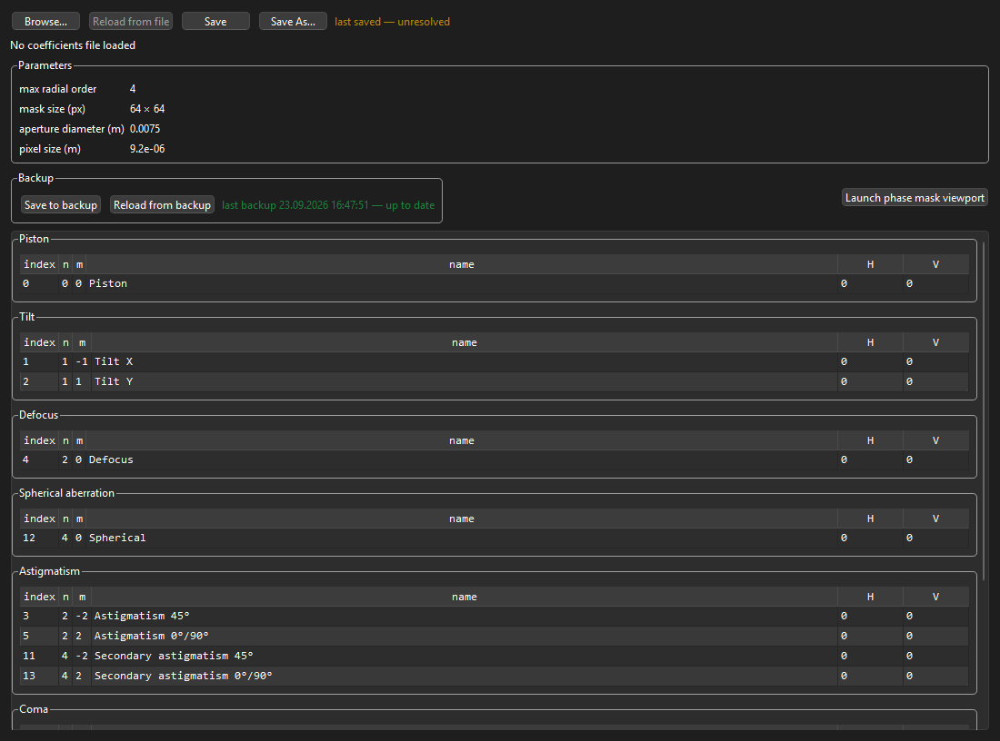

# Zernikes

ModeLab Zernike basis and phase-mask synthesis for SLM holography. Built on the ModeLab packaging stack: install a tagged release instead of `sys.path` hacks.

## Package layout

```
zernikes/
├── pyZernikes.py            Zernikes class (basis, phase synthesis, scans)
├── coef_sync.py             on-demand JSON / backup sync check
├── zernike_catalog.py       index ↔ (n, m) ↔ names; aberration groups
├── utils.py                 JSON load/save and coefficient assembly
├── ui/                      optional PySide6 editor + pyqtgraph viewport
├── tests/                   notebook launcher
├── scripts/release.py       git-tag release automation
├── pyproject.toml           package metadata + version
└── CHANGELOG.md
```

## Canonical imports

```python
from zernikes import Zernikes
from zernikes.zernike_catalog import iter_modes_by_group, ABERRATION_GROUPS
from zernikes.ui import ZernikesWidget  # requires the gui extra
```

## Coefficient model

Weights live in unified vectors `w_h` and `w_v`, one entry per basis index:

| Index | (n, m) | Name (n ≤ 4) |
|------:|--------|--------------|
| 0 | (0, 0) | Piston |
| 1 | (1, −1) | Tilt X |
| 2 | (1, +1) | Tilt Y |
| 4 | (2, 0) | Defocus |
| … | … | … |

Named attributes are aliases into the array:

```python
z.piston_h = 0.1      # same as z.w_h[0] = 0.1
z.tilt_x_h = 0.05     # same as z.w_h[1] = 0.05
z.w_h[Zernikes.nm_to_idx(2, 0)] = 0.2  # defocus
```

## Quick start

```python
from zernikes import Zernikes

z = Zernikes(
    max_zernike_radial_number=6,
    mask_size_x_in_pixels=64,
    mask_size_y_in_pixels=64,
)

df = z.generate_table()       # pandas DataFrame if pandas is installed
z.calculate_znk_phase_mask()

phase_h = z.znk_phase_h       # real wrapped phase in [-π, π] radians
phase_v = z.znk_phase_v
```

## Aberration groups

Modes are classified in `zernikes.zernike_catalog` for the UI and for group-wise optimization:

| Key | Rule |
|-----|------|
| `piston` | n = 0 |
| `tilt` | n = 1 |
| `defocus` | m = 0, n = 2 |
| `spherical` | m = 0, n ≥ 4 |
| `astigmatism` | \|m\| = 2 |
| `coma` | \|m\| = 1, n ≥ 3 |
| `foil` | \|m\| ≥ 3 |

```python
from zernikes.zernike_catalog import iter_modes_by_group, ABERRATION_GROUPS

groups = iter_modes_by_group(z.max_zernike_radial_number)
# groups["defocus"] → [(4, 2, 0), ...]   each tuple is (index, n, m)

coefs, idxs = z.filter_coefficients_by_aberration_keys("H", "defocus", "foil")
# coefs = z.w_h[idxs]   idxs are sorted, unique basis indices
```

## In-memory backup

Snapshot and restore coefficient vectors without touching disk:

```python
z.write_backup_of_zernike_coefs()   # copy w_h/w_v → b_w_h/b_w_v
z.read_backup_of_zernike_coefs()  # restore from backup
```

File load in the widget also refreshes the backup after each load.

## Init vs scan workflow

**Normal init** (load or clean → backup → synthesize):

```python
z = Zernikes(...)                         # loads config/zernike_coeffs.json if present
z = Zernikes(..., coefs_path="old.json")  # that file; falls back to the default, then zeros
z = Zernikes(..., coefs_path=None)        # clean start, ignores the default file
# __init__ already calls write_backup_of_zernike_coefs()
# and calculate_znk_phase_mask(restore_coefs=False)
```

**Tilt/defocus scan** (temporary offsets, then restore):

```python
z.modify_zernike_coefs(scan_tilt=True, tilt_x=0.01, tilt_y=0.0)
z.calculate_znk_phase_mask(restore_coefs=True)

z.modify_zernike_coefs(scan_defocus=True, defocus=0.05)
z.calculate_znk_phase_mask(restore_coefs=True)
```

## JSON coefficients

Save / load uses compact JSON (piston, tilts, and higher-order `w` for n ≥ 2).
Every file starts with a preamble (`schema`, `version`, `saved_at`). The schema name
is what identifies the file; the filename is only where it lives. The default file
is `config/zernike_coeffs.json` inside the package. Mask centers are not stored.
If the file's `max_zernike_radial_number` differs from the instance, the instance wins;
extra file modes are ignored and missing modes default to zero (with warnings).

```python
z.save_coefs("coefs.json")    # updates z.coefs_path; does not replace the default file
z.load_coefs("coefs.json")
z.calculate_znk_phase_mask()
z.coeffs_status_sync()        # {"json": {timestamp, sync}, "backup": {timestamp, sync}}
```

`sync` is `True` when that copy matches the current weights, `False` when it does not,
and `None` when the copy does not exist yet. The engine does not refresh this on every
write. Call it when you want the answer; the GUI calls it from `refresh_from_zernikes`
and after a cell edit.

## SLM integration

Pass real phase masks to `pyLCOS` (not complex fields):

```python
slm.ModMuxMask.H.zernike = z.znk_phase_h
slm.ModMuxMask.V.zernike = z.znk_phase_v
slm.setmask(pol="HV")
```

Phase wrapping matches `pyLCOS._addMasks`: coefficients are summed in the basis,
then wrapped to `[-π, π]` via `((π·φ + π) mod 2π) − π`.

## UI widget

PySide6 editor for an existing `Zernikes` instance. Install the **`gui`** extra (**PySide6**; the optional phase viewport also needs **pyqtgraph**).

Features:

- Load / save / reload JSON coefficients, with last-saved and last-backup status
- Coefficient tables grouped by aberration family (piston, tilt, defocus, …)
- In-memory **Save to backup** / **Reload from backup**
- Optional **Launch phase mask viewport** (H and V phase maps, grayscale −π…π)

```python
from zernikes import Zernikes
from zernikes.ui import ZernikesWidget

z = Zernikes(max_zernike_radial_number=6, mask_size_x_in_pixels=256, mask_size_y_in_pixels=256)
gui = ZernikesWidget(z)
gui.show()
```

When coefficients are changed **outside** the widget (e.g. from another script or optimizer), sync the GUI and phase:

```python
z.tilt_x_h = 0.05
gui.refresh_from_zernikes()   # updates tables and path label
gui._regenerate_phase()       # recalculates masks and open viewport
```

<!-- gui-screenshot -->

<!-- /gui-screenshot -->

See [`tests/zernikes_widget.ipynb`](tests/zernikes_widget.ipynb) for a notebook launcher (`%gui qt`).

## Static helpers

```python
Zernikes.nm_to_idx(2, 0)   # → 4 (defocus)
Zernikes.idx_to_nm(4)      # → (2, 0)
```

## Installation

### From GitHub (tagged release)

```bash
pip install "zernikes[gui] @ git+https://github.com/MarKo7s/zernikes.git@v1.1.0"
```

Core only (no Qt widgets):

```bash
pip install "zernikes @ git+https://github.com/MarKo7s/zernikes.git@v1.1.0"
```

Other packages can pin the same dependency in `pyproject.toml`:

```toml
dependencies = [
  "zernikes @ git+https://github.com/MarKo7s/zernikes.git@v1.1.0",
]
```

### Local development (editable install)

```bash
git clone git@github.com:MarKo7s/zernikes.git
cd zernikes
pip install -e ".[gui,notebooks]"
```

### Conda environment

Conda provides **Python + pip only**. Install numpy / PySide6 with **pip** so conda Qt DLLs do not conflict with PySide6 on Windows.

```bash
conda create -n zernikes python=3.11 pip -y
conda activate zernikes
pip install -e ".[gui,notebooks]"
```

Register a Jupyter kernel (once):

```bash
python -m ipykernel install --user --name zernikes --display-name "Python (zernikes)"
```

## Developer notes

### Versioning

The package version is defined in **one place only**: `pyproject.toml` → `[project].version`.

Do **not** edit `__init__.py` on each release. `zernikes.__version__` is read from pip metadata after install (`importlib.metadata`).

```bash
pip show zernikes
python -c "import zernikes; print(zernikes.__version__)"
```

Use [semantic versioning](https://semver.org/): `MAJOR.MINOR.PATCH`.

### Releasing a new version

1. Add an entry for the new version at the top of `CHANGELOG.md`.
2. Bump `version` in `pyproject.toml`.
3. Commit all changes (including the changelog).
4. Run the release script from the repo root:

```bash
python scripts/release.py --from-changelog
```

The script reads the version from `pyproject.toml`, pushes `main`, creates annotated git tag `vX.Y.Z`, and pushes the tag. With `--from-changelog`, the tag message is taken from the matching `CHANGELOG.md` section.

After that:

```bash
pip install "zernikes[gui] @ git+https://github.com/MarKo7s/zernikes.git@vX.Y.Z"
```

Dry run:

```bash
python scripts/release.py --from-changelog --dry-run
```

Optional GitHub Release (`gh` CLI):

```bash
gh release create vX.Y.Z --title "zernikes X.Y.Z" --notes-file CHANGELOG.md
```

**Requirements before release:** clean working tree; tag `vX.Y.Z` must not already exist on GitHub.
